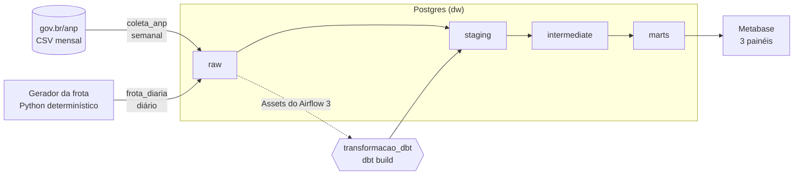
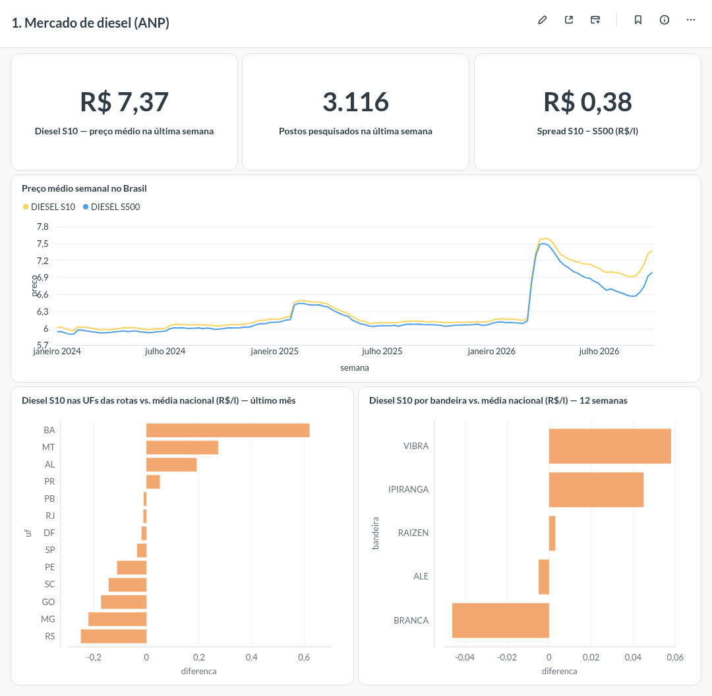
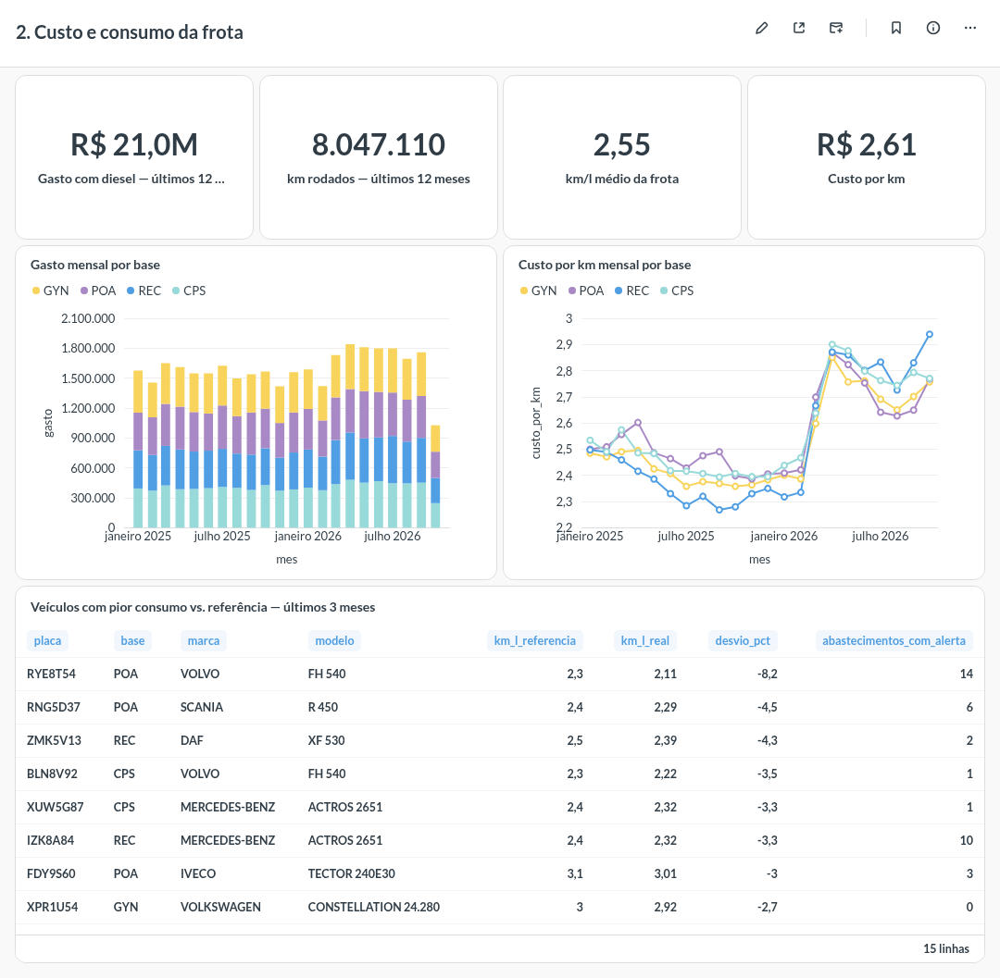
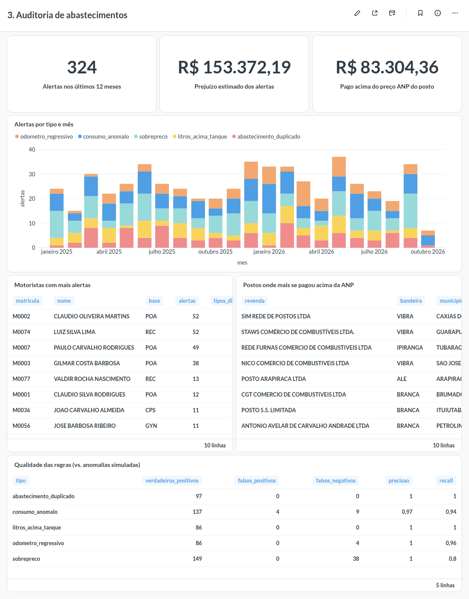

# Diesel na estrada: preços da ANP × abastecimentos de uma frota

Pipeline de dados ponta a ponta que coleta a **pesquisa semanal de preços de combustíveis da ANP**
(dados abertos, ~740 mil coletas em 11 mil postos desde 2024) e cruza com os **abastecimentos de
uma transportadora** para responder perguntas que todo gestor de frota faz:

- Estamos pagando acima do preço que o posto pratica? Quanto isso custa por mês?
- Qual o km/l real de cada caminhão comparado à referência do modelo? E o custo por km?
- Quais abastecimentos são suspeitos (sobrepreço, desvio de combustível, odômetro adulterado)?
- Quais motoristas e postos concentram os problemas?

A frota é **simulada**, mas abastece em **postos reais** da pesquisa ANP, ao preço que a ANP
coletou naquele posto. O gerador injeta anomalias conhecidas, então dá para medir a
**precisão e o recall** das regras de auditoria, como num problema real de detecção de fraude.

## Arquitetura



| Camada | Ferramenta | O que faz |
|---|---|---|
| Orquestração | **Airflow 3** | 3 DAGs; o dbt é disparado por **Assets** quando a ANP ou a frota recebem dados |
| Ingestão | **Python** (httpx, psycopg `COPY`) | Coleta idempotente por competência/dia, validação de layout |
| Armazenamento | **Postgres 17** | Data warehouse com schemas `raw → staging → intermediate → marts` |
| Transformação | **dbt** | 15 modelos, 39 testes de dados, documentação e lineage |
| Visualização | **Metabase** | 3 painéis provisionados por código (API), não por cliques |
| Qualidade | **pytest, ruff, sqlfluff, GitHub Actions** | CI roda lint, testes e `dbt build` com uma amostra real da ANP a cada push |

## Como rodar

Pré-requisito: Docker. Na primeira vez, a carga baixa ~140 MB da ANP e leva uns 5 minutos.

```bash
make up              # Postgres, Airflow (localhost:8080) e Metabase (localhost:3000)
make carga-inicial   # ANP desde 2024-01, frota desde 2025-01, dbt build e painéis
```

- Airflow: http://localhost:8080 (sem login, ambiente local)
- Metabase: http://localhost:3000, usuário `admin@anp-frota.local`, senha `Painel#ANP2026`

Depois disso os DAGs mantêm tudo atualizado: a frota gera o dia anterior toda madrugada, a ANP
é verificada toda segunda e cada carga dispara o dbt.

## Painéis

| Mercado de diesel (ANP) | Custo e consumo da frota | Auditoria |
|---|---|---|
|  |  |  |

## Os dados

### ANP: Série Histórica de Preços de Combustíveis

Fonte: [gov.br/anp, dados abertos](https://www.gov.br/anp/pt-br/centrais-de-conteudo/dados-abertos/serie-historica-de-precos-de-combustiveis).
Arquivos mensais com as coletas semanais de diesel S10, diesel S500 e GNV por posto (CNPJ,
endereço, bandeira, preço de bomba).

Problemas reais que o pipeline trata:

- **Nome de arquivo muda de um mês para outro** (`precos-diesel-gnv-01.csv`,
  `04-dados-abertos-precos-diesel-gnv` sem extensão, `06-dados-abertos-precos-2026-06-diesel-gnv.csv`...).
  O extrator tenta os padrões conhecidos e trata 404 como "ainda não publicado".
- **Atraso de publicação** (~1 mês). Os meses recentes são recarregados a cada execução, e
  abastecimentos sem preço de referência ficam como "pendente" em vez de virar falso alerta.
- **Coletas duplicadas** (mesmo posto, produto e dia) → deduplicadas no staging, com teste de unicidade.
- **Aspas no meio de campos** (`ABASTECEDORA E GARAGEM"SS"LTDA`) → o `COPY CSV` do Postgres
  quebraria, então o parse é feito com o módulo `csv` do Python e validado contra o cabeçalho esperado.
- **CNPJ com espaço e pontuação**, S500 chamado só de "DIESEL", **1.160 postos que trocaram de
  bandeira** no período → normalizados no staging.

### Frota simulada

`src/pipeline/frota.py` gera 60 caminhões (Scania, Volvo, Mercedes...) e 88 motoristas em 4
bases (Porto Alegre, Campinas, Goiânia, Recife), com regras de negócio de verdade:

- caminhões a partir de 2012 (PROCONVE P7) usam **S10**; os mais antigos, **S500**;
- cada veículo tem ~6 **postos conveniados** nas UFs das suas rotas (rendezvous hashing, estável
  quando a ANP inclui ou remove postos) e às vezes abastece fora deles;
- o km/l varia em torno da referência do modelo, e o preço pago é o da ANP para aquele posto ± 1%;
- ~2% dos abastecimentos recebem uma anomalia, concentrada em alguns motoristas "propensos".

É **determinístico**: cada dia é função da data. Reprocessar um dia, um mês ou tudo gera
exatamente as mesmas linhas, então os DAGs são idempotentes e o CI é reproduzível.

## Modelagem (dbt)

```
staging       stg_anp__precos · stg_frota__veiculos · stg_frota__motoristas · stg_frota__abastecimentos
intermediate  int_anp__precos_semanais (posto × produto × semana + mediana do município)
              int_frota__abastecimentos_enriquecidos (odômetro anterior + preço ANP do posto)
marts         dim_posto · dim_veiculo · dim_motorista
              fct_abastecimento · fct_preco_anp_semanal
              mart_frota_mensal · mart_alertas · mart_avaliacao_regras
```

O cruzamento principal: cada abastecimento busca o preço que a ANP coletou **no mesmo posto
(CNPJ) e produto, na mesma semana**; se o posto não foi pesquisado naquela semana, vale a coleta
mais recente dentro de 3 semanas (`LEFT JOIN LATERAL`). O km/l usa o método do **tanque cheio**:
km desde o abastecimento anterior ÷ litros do atual.

A documentação com lineage é publicada no GitHub Pages pelo CI.

### Regras de auditoria

Limites configuráveis em `dbt_project.yml` (`vars`):

| Regra | Condição | Precisão | Recall |
|---|---|---|---|
| Sobrepreço | pago > preço ANP do posto + 5% | 1,00 | 0,80 |
| Consumo anômalo | km/l < 75% da referência (e sem outra regra explicando) | 0,97 | 0,94 |
| Litros acima do tanque | litros > capacidade do tanque | 1,00 | 1,00 |
| Abastecimento duplicado | mesmo veículo em < 2 h | 1,00 | 1,00 |
| Odômetro regressivo | odômetro menor que o anterior | 1,00 | 0,96 |

Leitura: o recall de sobrepreço fica em 80% porque ~20% dos abastecimentos não têm preço ANP
de referência (posto fora da amostra da semana ou mês ainda não publicado), uma limitação
real de usar a pesquisa da ANP como referência. No odômetro, erros de digitação menores que o
km rodado no dia são indetectáveis por essa regra.

### Qualidade de dados

- **Testes genéricos**: `unique`, `not_null`, `relationships` (todo abastecimento aponta para
  posto, veículo e motorista existentes), `accepted_values` (produtos, 27 UFs).
- **dbt_utils**: unicidade composta, faixa de preço (R$ 2 a 15), CNPJ com 14 dígitos.
- **Freshness**: alerta se a ANP passar de 45 dias sem dados e falha após 75.
- **Testes singulares de negócio**: valor total = litros × preço; cobertura de preço de
  referência ≥ 80%; **regressão das regras** (cada regra precisa ter recall ≥ 70%, então quem
  mexer num limite e piorar a detecção quebra o CI).

## Decisões e trade-offs

- **ELT**: o raw da ANP é guardado como texto, igual ao arquivo; a tipagem fica no dbt. Se a
  ANP mudar um formato, nada se perde na ingestão e a correção é só SQL.
- **Idempotência em tudo**: ANP substitui a competência inteira; frota substitui o período.
  Rodar de novo nunca duplica.
- **Assets em vez de sensores**: o dbt roda quando há dado novo, sem polling nem horário fixo.
- **Painéis como código**: `metabase/provisionar.py` recria os painéis pela API, então eles
  ficam versionados e qualquer pessoa sobe o mesmo resultado.
- **Airflow `standalone`**: um container só, suficiente para o volume do projeto. Em produção
  separaria scheduler, api-server e workers.

## Estrutura

```
dags/               coleta_anp · frota_diaria · transformacao_dbt (+ ativos.py com os Assets)
src/pipeline/       anp.py (coleta) · frota.py (gerador) · db.py (conexão e DDL do raw)
dbt/                modelos, testes e macros
metabase/           provisionamento dos painéis
tests/              pytest + amostra real da ANP usada no CI
docker/             Dockerfile do Airflow (com dbt num venv separado) e init do Postgres
```

Desenvolvimento local (requer [uv](https://docs.astral.sh/uv/)): `uv sync`, `make test`,
`make lint`, `make docs`.

## Próximos passos

- Incluir gasolina e etanol (veículos leves de apoio).
- Geolocalizar postos por CEP para mapas e para estimar desvio de rota.
- Rodar o dbt como tasks individuais no Airflow (Cosmos) para reprocessar só o que falhou.
- Deploy em nuvem com Postgres gerenciado.
